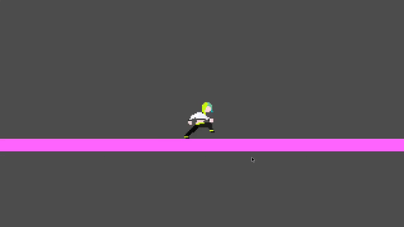

# Cyberpunk rhythm platformer
> A game where your purpose is to hit, jump, dodge: enemies, obstacles in a fun rhythm gamemode

**How to play:**

- Open it at [itch.io](https://orangopontotango.itch.io/cyberpunk-rhythym-game)
- Click play
- You will be in the idle state for 13 seconds and then you start running where you can:
	- Jump with variable heights with the Space Bar

made with <3 and struggle in Godot.
