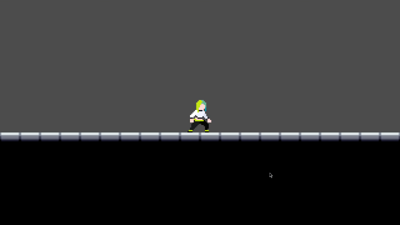

# Cyberpunk rhythm platformer
> A cyberpunk rhythm platformer with parkour and enemies where you have to hit, dash,  jump on beat of the song with aggressive music like breakcore / dnb

**How to play:**

- Open it at [itch.io](https://orangopontotango.itch.io/cyberpunk-rhythym-game)
- Click play
- You will be in the idle state for 13 seconds and then you start running where you can:
	- Jump with variable heights with the Space Bar
	- Slide with variable length with Shift key
	- Die and respawn

The game is still very simple as this is my first game ever and I'm a really beginer on gamedev so uhh development is really slow 

made with <3 and struggle in Godot.
